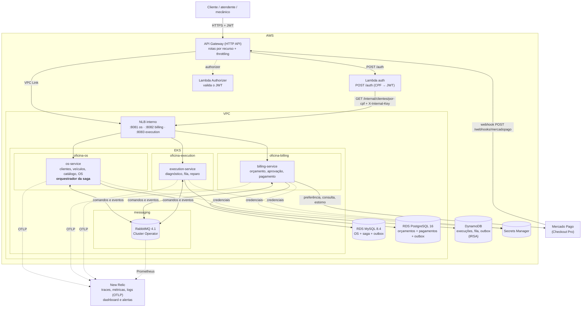
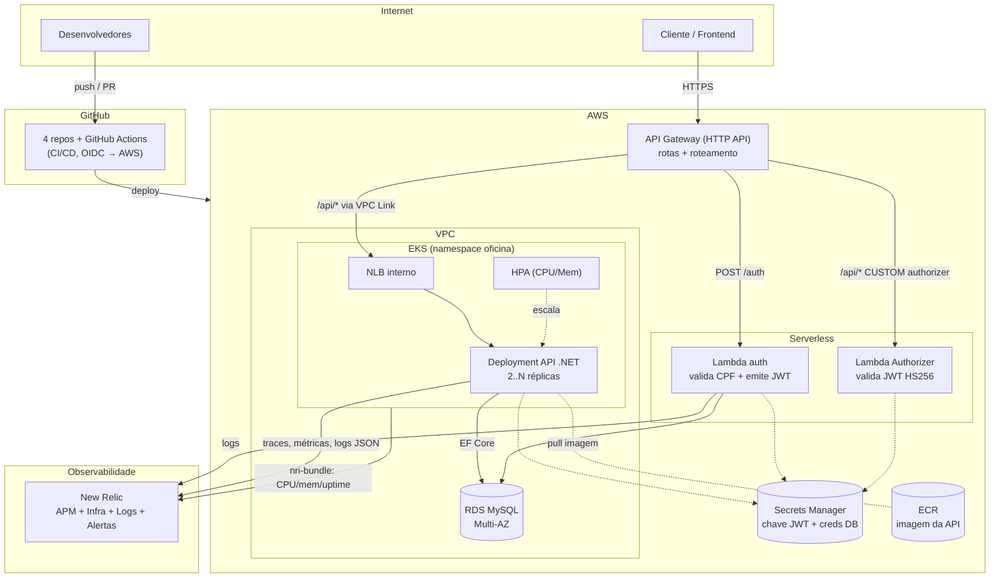

# Diagrama de componentes

Fase 4: três microsserviços no EKS, cada um com o seu banco, conversando por eventos e comandos no
RabbitMQ. A saga da OS é orquestrada pelo os-service. Contratos das mensagens:
[`docs/contratos-mensagens.md`](../contratos-mensagens.md).

## Componentes

| Componente | Onde | Responsabilidade |
| --- | --- | --- |
| API Gateway | API Gateway (HTTP API) | Entrada única. Rotas por recurso para cada serviço (VPC Link → listener do serviço no NLB), JWT nas rotas `/api/*`, rotas públicas com throttling (`POST /auth`, `POST /api/auth/login`, webhook do Mercado Pago). `/internal/*` e `/dev/*` não são expostos. |
| Lambda auth | AWS Lambda (Node 20) | Valida o CPF, consulta o cliente no os-service (endpoint interno, chave no header) e emite o JWT do cliente. |
| Lambda Authorizer | AWS Lambda (Node 20) | Valida o JWT HS256 antes de encaminhar ao serviço. |
| os-service | EKS, `oficina-os` | Clientes, veículos, catálogo de serviços e peças (estoque), abertura e histórico da OS. Orquestra a saga (MassTransit state machine, estado no MySQL). |
| billing-service | EKS, `oficina-billing` | Orçamento a partir do diagnóstico, aprovação ou recusa pelo cliente, cobrança e estorno no Mercado Pago (webhook com assinatura). |
| execution-service | EKS, `oficina-execution` | Fila da oficina, diagnóstico, reparo e finalização. |
| RabbitMQ | EKS, `messaging` | Comandos (filas por serviço) e eventos (exchanges). Um usuário por serviço, volume EBS gp3. |
| Bancos | RDS MySQL, RDS PostgreSQL, DynamoDB | Um banco por serviço (ADR-008). O DynamoDB é acessado pela role IRSA do pod, sem chaves. |
| Outbox/inbox | Nos 3 serviços | Estado e mensagens gravados juntos (MassTransit EF outbox no MySQL e no PostgreSQL; outbox próprio no DynamoDB). O inbox descarta mensagem repetida. |
| Secrets Manager | AWS | Credenciais dos bancos e do RabbitMQ, chave do JWT, chave interna e as credenciais do Mercado Pago. |
| Observabilidade | New Relic | Traces distribuídos (o contexto passa pelos headers das mensagens), métricas de negócio, logs ligados ao trace, dashboard "Saga de OS" e alertas. |
| CI/CD | GitHub Actions | Por repositório: testes, cobertura ≥ 80%, SonarCloud e deploy no EKS a cada merge em `homolog`/`prod`. |

---

## Fase 3 (histórico): diagrama de componentes

A Fase 3 tinha um serviço só (a API .NET num Deployment do EKS) e um RDS MySQL.

Visão de nuvem (AWS) com APIs, banco e monitoramento.

### Componentes

| Componente | Serviço AWS | Responsabilidade |
| --- | --- | --- |
| API Gateway | API Gateway (HTTP API) | Ponto único de entrada, roteamento e proteção das rotas `/api/*`. |
| Lambda auth | AWS Lambda (Node 20) | Valida CPF, consulta cliente no RDS, emite JWT. |
| Lambda Authorizer | AWS Lambda (Node 20) | Valida o JWT HS256 antes de encaminhar ao app. |
| API .NET | EKS (Deployment + Service/NLB) | Regras de negócio (OS, clientes, veículos, peças, serviços). |
| Escalabilidade | HPA + Cluster Autoscaler | Ajuste de réplicas/nós por CPU/memória. |
| Banco | RDS for MySQL (Multi-AZ) | Persistência transacional com alta disponibilidade. |
| Segredos | Secrets Manager | Chave do JWT e credenciais do banco (fonte única). |
| Registry | ECR | Imagens Docker da API. |
| Observabilidade | New Relic | APM, métricas de infra, logs estruturados, dashboards e alertas. |
| CI/CD | GitHub Actions | Build, testes e deploy automático (homolog/prod) por repositório. |
