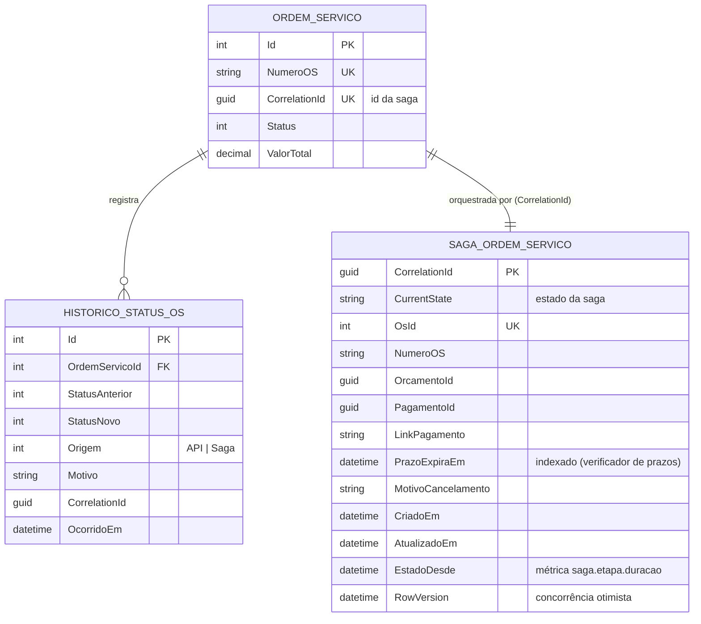
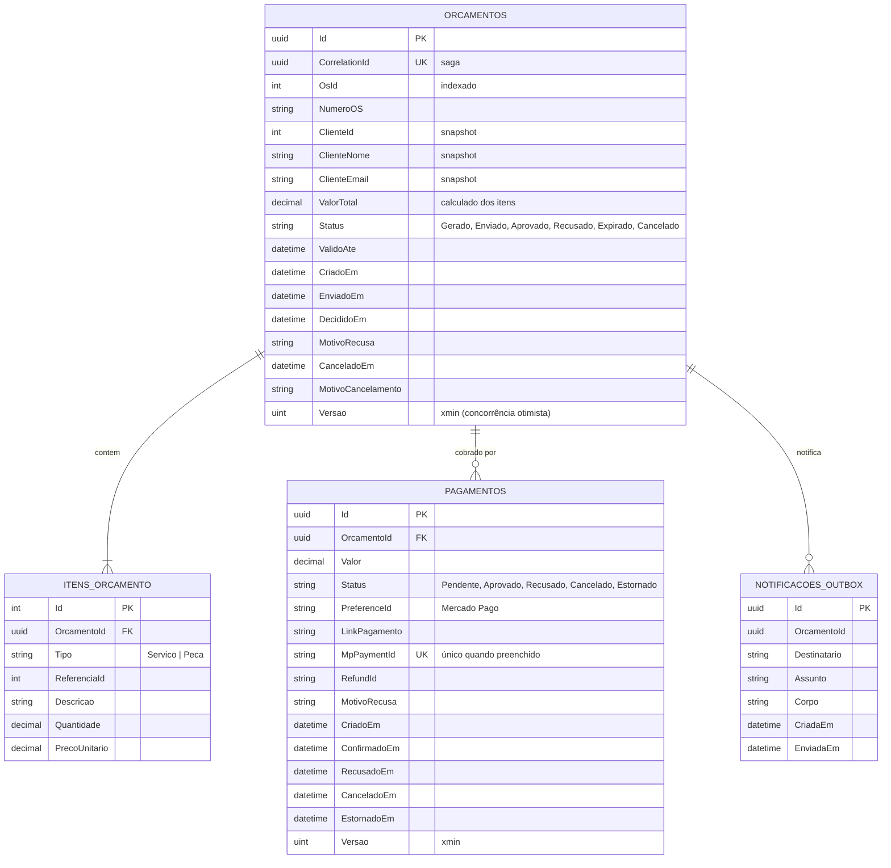
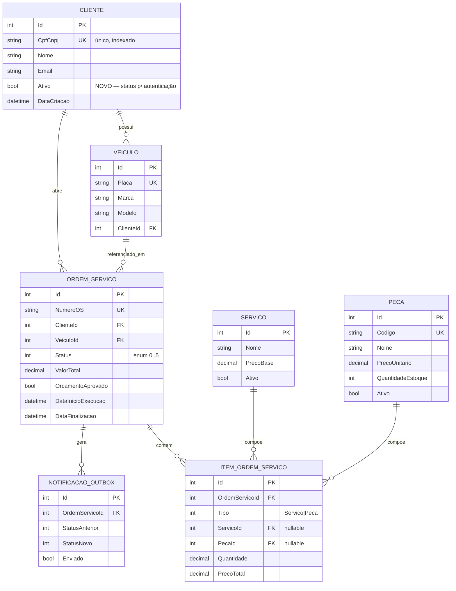

# Modelo de dados

Fase 4: um banco por serviço ([ADR-008](adrs/ADR-008-persistencia-poliglota.md)). Nenhum serviço lê o banco
do outro. O que um serviço precisa do outro chega pelas mensagens: o billing guarda uma cópia do
cliente e dos itens da OS no orçamento (*snapshot*).

## os-service: MySQL 8.4 (RDS)

O modelo da Fase 3 (seção de histórico, abaixo) continua. A Fase 4 acrescentou o histórico de status,
a correlação com a saga, o estado da saga e as tabelas do outbox/inbox do MassTransit.

Tabelas do MassTransit (EF outbox/inbox): `OutboxMessage` (mensagens a enviar), `OutboxState` (entrega
do outbox) e `InboxState` (mensagens já consumidas, por `MessageId` e consumer).

## billing-service: PostgreSQL 16 (RDS)

Também aqui ficam as tabelas do outbox/inbox do MassTransit (`OutboxMessage`, `OutboxState`, `InboxState`).

## execution-service: DynamoDB (tabela única)

Uma tabela (`oficina-execucoes`), com dois índices secundários globais (GSI). As gravações de uma operação
(execução, apontamentos, outbox e marca de mensagem processada) vão num `TransactWriteItems` só, com
condição na versão da execução (concorrência otimista).

| Item | PK | SK | GSI1 (fila) | GSI2 (outbox) | Observação |
| --- | --- | --- | --- | --- | --- |
| Execução | `EXEC#{osId}` | `META` | `FILA#{etapa}` / `{etapaDesde}#{osId}` | | Estado, etapa, serviços aprovados, versão |
| Apontamento | `EXEC#{osId}` | `EVT#{em}#{id}` | | | Histórico da execução (diagnóstico, reparo, finalização) |
| Mensagem processada (inbox) | `MSG#{messageId}` | `MSG` | | | Descarta a mensagem repetida; TTL em `ExpiraEm` |
| Outbox | `OUTBOX#{id}` | `OUTBOX` | | `OUTBOX` / `{criadoEm}#{id}` | Evento a publicar, com o `traceparent` de quem gravou |

| Padrão de acesso | Como |
| --- | --- |
| Execução de uma OS (com os apontamentos) | `Query` em `PK = EXEC#{osId}` |
| Fila de uma etapa, por ordem de chegada | `Query` no GSI1 em `GSI1PK = FILA#{etapa}` (ordenado por `GSI1SK`) |
| Mensagem já processada? | `ConditionCheck`/`Put` com `attribute_not_exists` em `MSG#{messageId}`, dentro da transação |
| Eventos pendentes de publicação | `Query` no GSI2 em `GSI2PK = OUTBOX` (os mais antigos primeiro) |
| Gravar uma mudança | `TransactWriteItems` com condição na versão da execução |

---

## Fase 3 (histórico): modelo de dados

A Fase 3 tinha um serviço só (a API .NET num Deployment do EKS) e um RDS MySQL.

### Diagrama ER

### Relacionamentos

- **Cliente 1—N Veículo** (cascade): excluir o cliente remove seus veículos.
- **Cliente 1—N OrdemServico** e **Veículo 1—N OrdemServico** (restrict): uma OS não
  deixa cliente/veículo órfãos; impede exclusão enquanto houver OS.
- **OrdemServico 1—N ItemOrdemServico** (cascade): os itens pertencem à OS.
- **ItemOrdemServico N—1 Serviço/Peça** (set null): o item referencia um serviço **ou**
  uma peça (discriminado por `Tipo`); apagar o cadastro base preserva o histórico do item.
- **OrdemServico 1—N NotificacaoOutbox**: cada transição de status gera um registro (padrão outbox).

### Justificativa da escolha do banco (MySQL / RDS)

1. **Modelo fortemente relacional e transacional.** O domínio é normalizado, com integridade
   referencial (FKs, cascatas/restrições) e transações na criação de OS e movimentação de
   estoque — cenário natural para um SGBD relacional, não NoSQL.
2. **Continuidade com a base existente.** A aplicação (Fases 1–2) já usa MySQL via EF Core;
   manter o motor evita troca de provider, regeração de migrations e retrabalho nos testes de
   integração (Testcontainers/MySQL), reduzindo risco.
3. **Serviço gerenciado com HA.** O Amazon RDS for MySQL oferece **Multi-AZ** (failover
   automático), backups, patching e métricas — atendendo alta disponibilidade e performance
   sem operar o banco manualmente.
4. **Custo/adequação.** Para a carga de uma oficina (mesmo multi-unidade), MySQL em instância
   pequena atende com folga; recursos como réplicas de leitura podem ser adicionados sob demanda.

> RFC completa: [RFC-002 — Escolha do banco de dados](rfcs/RFC-002-escolha-banco.md).

### Ajustes no modelo (Fase 3)

| Ajuste | Motivo |
| --- | --- |
| **`Cliente.Ativo`** (bool, default true) | A Function Serverless precisa consultar o **status** do cliente; clientes inativos não autenticam. |
| **Índice único `IX_Cliente_CpfCnpj`** | Já existente; garante unicidade e acelera a busca por CPF feita pela Lambda (consulta no caminho crítico de login). |
| Índices únicos em `Veiculo.Placa`, `Peca.Codigo`, `OrdemServico.NumeroOS` | Consistência de identificadores de negócio e performance de lookup. |
| `Status`/`Tipo` persistidos como `int` (enum) | Compactação e ordenação eficientes; semântica documentada no domínio. |
