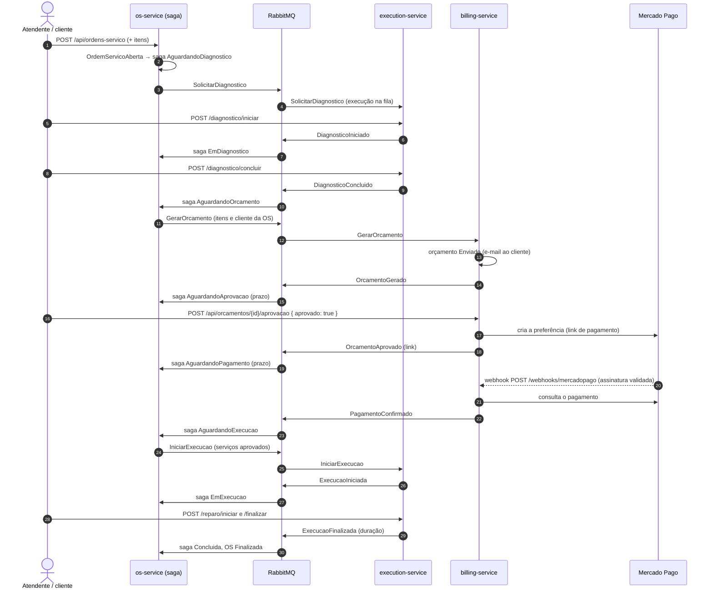
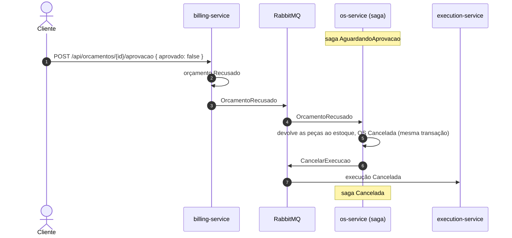
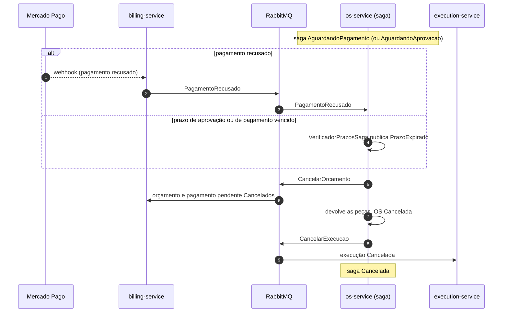
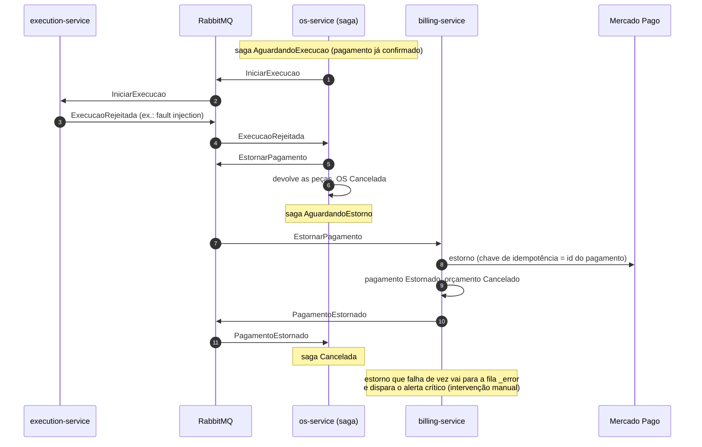
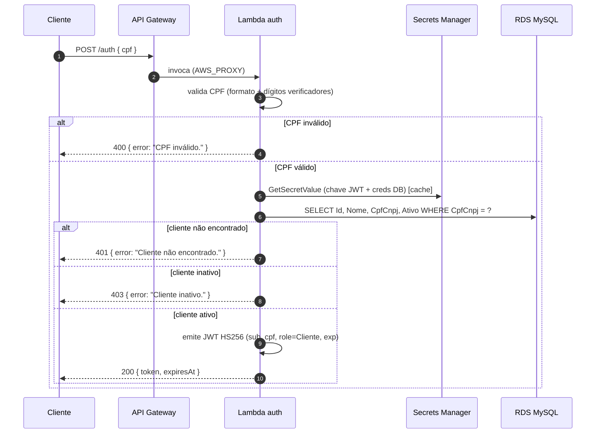
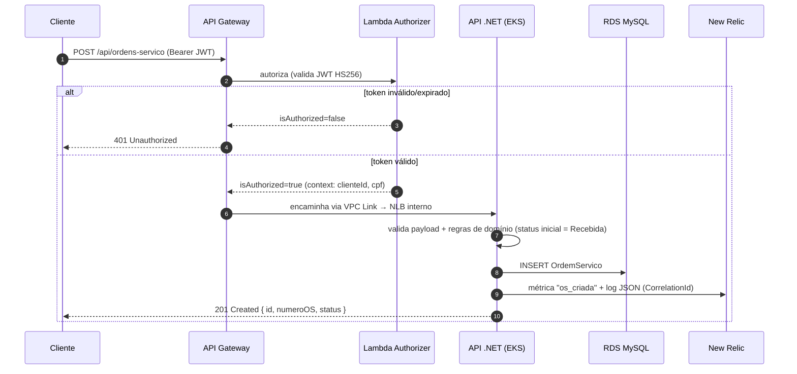

# Diagramas de sequência

Fase 4: a saga da OS nos 3 serviços. Os nomes das mensagens são os do
[catálogo de contratos](../contratos-mensagens.md), e a máquina de estados completa (com os eventos
fora de ordem) está na seção 4 dele. Os comandos vão para a fila do serviço de destino; os eventos são
publicados e a saga do os-service os consome. Todas as mensagens saem por outbox, na mesma transação
da mudança de estado.

## 1. Caminho feliz

## 2. C1: orçamento recusado

## 3. C2: pagamento recusado ou prazo vencido

## 4. C3: execução rejeitada, com estorno

O prazo da execução (`AguardandoExecucao` sem `ExecucaoIniciada`) segue o mesmo caminho do C3, e a saga
também manda `CancelarExecucao`.

---

## Fase 3 (histórico): diagramas de sequência

A Fase 3 tinha um serviço só (a API .NET num Deployment do EKS) e um RDS MySQL.

### 1. Autenticação por CPF

### 2. Abertura de Ordem de Serviço (rota protegida)

> O app .NET mantém validação JWT Bearer própria (defesa em profundidade), usando a
> mesma chave/issuer/audience via Secrets Manager.
