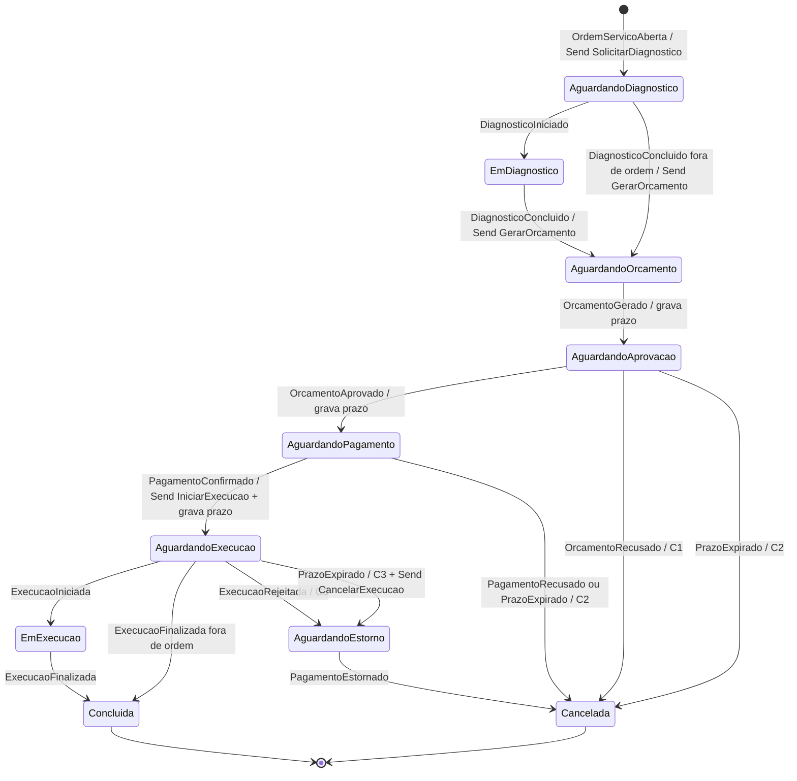

# Contratos de mensagens — v1

> **Status:** rascunho para revisão das frentes A (`os-service`), B (`billing-service`) e C (`execution-service`).
> Plano: [Etapa 0, item 0.4](fase4/etapa-0-fundacao.md#04-contratos-de-mensagens-v1).
> Este arquivo é a fonte da verdade da integração entre os serviços. Só muda por PR aprovado pelas frentes afetadas.

## 1. Convenções

### 1.1 Envelope de negócio

Toda mensagem carrega estes campos, além dos específicos:

| Campo | Tipo | Descrição |
| --- | --- | --- |
| `CorrelationId` | `Guid` | Id da saga. Gerado pelo `os-service` na abertura e gravado em `OrdemServico.CorrelationId`. |
| `OsId` | `int` | Id da OS no `os-service`. |
| `NumeroOS` | `string` | Número legível da OS, usado em logs, telas e busca no New Relic. |
| `OcorridoEm` | `DateTime` (UTC) | Quando o fato aconteceu ou o comando foi emitido. |

`MessageId`, `ConversationId` e os headers de trace continuam no envelope do MassTransit. O `CorrelationId` acima é o de negócio.

### 1.2 Nomes, URN e exchange

- A classe C# tem o nome da mensagem como está no [catálogo](#2-catálogo-v1).
- Os três repos usam o **mesmo namespace**, `Oficina.Contracts`.
- Toda classe declara dois atributos:
  - `[MessageUrn("oficina:<nome-kebab>:v1")]`: identifica o tipo do lado de quem consome.
  - `[EntityName("oficina.<nome-kebab>.v1")]`: nome do exchange no RabbitMQ.
- Sem o `EntityName`, o exchange recebe o nome do namespace + classe. Se um repo mudar o namespace, o produtor e o consumidor passam a usar exchanges diferentes e a mensagem some sem erro. Os dois atributos deixam o nome explícito. **O spike S1 confirma esse comportamento.**

### 1.3 Versionamento

- **Compatível (continua v1):** adicionar campo opcional. O consumidor ignora o que não conhece e o produtor antigo manda o valor padrão.
- **Incompatível (vira v2):** remover, renomear ou mudar o tipo de um campo.
  - A v2 ganha novo URN e novo exchange.
  - O produtor publica v1 e v2 em paralelo até todos os consumidores migrarem.

### 1.4 Comandos, eventos e eventos internos

| Tipo | Como é enviado | Consumidores | Nome |
| --- | --- | --- | --- |
| Comando | `Send` para a fila do serviço dono ([seção 3](#3-topologia-no-rabbitmq)) | exatamente um | imperativo (`GerarOrcamento`) |
| Evento | `Publish` | zero ou mais, cada um com sua fila | particípio (`OrcamentoGerado`) |
| Evento interno | `Publish` | só o próprio `os-service` | particípio |

O evento interno passa pelo broker para aproveitar o outbox, o retry e o trace.

### 1.5 Serialização e tipos

- JSON (System.Text.Json, serializador padrão do MassTransit 8).
- Dinheiro em `decimal`, em reais (BRL), com 2 casas. Quantidade também em `decimal`.
- Datas sempre em UTC.
- Campo com valores fixos é `string`, nunca `enum`. Um `enum` vira número no JSON e passa a depender da ordem declarada em cada repo.
- Listas em `IReadOnlyList<T>`, nunca `null` (lista vazia quando não houver itens).

### 1.6 Confiabilidade

- **Todo consumidor é idempotente**, porque a mesma mensagem pode chegar mais de uma vez.
  - `os-service` e `billing-service`: inbox do MassTransit (EF Core).
  - `execution-service`: item `MSG#{messageId}` com escrita condicional e TTL no DynamoDB.
- **Toda publicação sai pelo outbox**, na mesma transação da mudança de estado.
  - `os-service` e `billing-service`: outbox do MassTransit.
  - `execution-service`: outbox próprio no DynamoDB.
- **Falha:** retry exponencial no consumidor + redelivery. Esgotou → fila `<fila>_error` + alerta no New Relic.

## 2. Catálogo v1

| # | Mensagem | Tipo | Produtor → consumidor | Campos além do envelope |
| --- | --- | --- | --- | --- |
| 1 | `SolicitarDiagnostico` | comando | os → execution | `Veiculo {Placa, Marca, Modelo, Ano}`, `Descricao?` |
| 2 | `DiagnosticoIniciado` | evento | execution → os | `Mecanico` |
| 3 | `DiagnosticoConcluido` | evento | execution → os | `Observacoes?` |
| 4 | `GerarOrcamento` | comando | os → billing | `Cliente {Id, Nome, Email?}`, `Itens[] {Tipo, ReferenciaId, Descricao, Quantidade, PrecoUnitario}`, `ValorTotal` |
| 5 | `OrcamentoGerado` | evento | billing → os | `OrcamentoId`, `ValorTotal`, `ValidoAte` |
| 6 | `OrcamentoAprovado` | evento | billing → os | `OrcamentoId`, `PagamentoId`, `LinkPagamento` |
| 7 | `OrcamentoRecusado` | evento | billing → os | `OrcamentoId`, `Motivo?` |
| 8 | `PagamentoConfirmado` | evento | billing → os | `PagamentoId`, `MpPaymentId`, `Valor` |
| 9 | `PagamentoRecusado` | evento | billing → os | `PagamentoId`, `Motivo` |
| 10 | `IniciarExecucao` | comando | os → execution | `Servicos[] {Descricao, Quantidade}` |
| 11 | `ExecucaoIniciada` | evento | execution → os | — |
| 12 | `ExecucaoRejeitada` | evento | execution → os | `Motivo` |
| 13 | `ExecucaoFinalizada` | evento | execution → os | `DuracaoSegundos` |
| 14 | `CancelarExecucao` | comando (compensação) | os → execution | `Motivo` |
| 15 | `CancelarOrcamento` | comando (compensação) | os → billing | `Motivo` |
| 16 | `EstornarPagamento` | comando (compensação) | os → billing | `PagamentoId`, `Motivo`. O estorno também cancela o orçamento. |
| 17 | `PagamentoEstornado` | evento | billing → os | `PagamentoId`, `Valor` |
| 18 | `OrdemServicoAberta` | evento interno | os → os | — (a saga carrega a OS do banco) |
| 19 | `PrazoExpirado` | evento interno | os → os | `EstadoNoMomento` |
| 20 | `CancelamentoSolicitado` | evento interno (opcional) | os → os | `Motivo`, `SolicitadoPor` |

`?` = opcional (pode vir `null`).

**Mudanças em relação ao rascunho do plano:**

- **Sai `Prioridade` de `SolicitarDiagnostico`:** a OS não tem esse campo hoje, e a fila do `execution-service` passa a ser por ordem de chegada. Se a prioridade voltar, entra como campo opcional, sem quebrar a v1.
- **`EstornarPagamento` passa a levar `PagamentoId`:** a saga já tem esse valor, recebido em `OrcamentoAprovado`.
- **Entram `OrdemServicoAberta` e `CancelamentoSolicitado`:** já eram citados na [Etapa 1](fase4/etapa-1-os-service.md), mas faltavam no catálogo.

### 2.1 Definição de referência (C#)

Cada repo copia só as mensagens que produz ou consome. Os nomes, URNs e campos devem ficar idênticos aos daqui.

```csharp
using MassTransit;

namespace Oficina.Contracts;

// ───────────── Envelope (não vira exchange no RabbitMQ) ─────────────
[ExcludeFromTopology]
public interface IMensagemOS
{
    Guid CorrelationId { get; }
    int OsId { get; }
    string NumeroOS { get; }
    DateTime OcorridoEm { get; }
}

[ExcludeFromTopology]
public abstract record MensagemOS : IMensagemOS
{
    public Guid CorrelationId { get; init; }
    public int OsId { get; init; }
    public string NumeroOS { get; init; } = string.Empty;
    public DateTime OcorridoEm { get; init; }
}

// ───────────── Tipos auxiliares ─────────────
public record VeiculoInfo
{
    public string Placa { get; init; } = string.Empty;
    public string Marca { get; init; } = string.Empty;
    public string Modelo { get; init; } = string.Empty;
    public int Ano { get; init; }
}

public record ClienteInfo
{
    public int Id { get; init; }
    public string Nome { get; init; } = string.Empty;
    public string? Email { get; init; }
}

public record ItemOrcamentoInfo
{
    /// <summary>"Servico" ou "Peca".</summary>
    public string Tipo { get; init; } = string.Empty;
    /// <summary>Id do serviço ou da peça no os-service.</summary>
    public int ReferenciaId { get; init; }
    public string Descricao { get; init; } = string.Empty;
    public decimal Quantidade { get; init; }
    public decimal PrecoUnitario { get; init; }
}

public record ServicoExecucaoInfo
{
    public string Descricao { get; init; } = string.Empty;
    public decimal Quantidade { get; init; }
}

// ───────────── os → execution ─────────────
[MessageUrn("oficina:solicitar-diagnostico:v1"), EntityName("oficina.solicitar-diagnostico.v1")]
public record SolicitarDiagnostico : MensagemOS
{
    public VeiculoInfo Veiculo { get; init; } = new();
    public string? Descricao { get; init; }
}

[MessageUrn("oficina:iniciar-execucao:v1"), EntityName("oficina.iniciar-execucao.v1")]
public record IniciarExecucao : MensagemOS
{
    public IReadOnlyList<ServicoExecucaoInfo> Servicos { get; init; } = [];
}

[MessageUrn("oficina:cancelar-execucao:v1"), EntityName("oficina.cancelar-execucao.v1")]
public record CancelarExecucao : MensagemOS
{
    public string Motivo { get; init; } = string.Empty;
}

// ───────────── execution → os ─────────────
[MessageUrn("oficina:diagnostico-iniciado:v1"), EntityName("oficina.diagnostico-iniciado.v1")]
public record DiagnosticoIniciado : MensagemOS
{
    public string Mecanico { get; init; } = string.Empty;
}

[MessageUrn("oficina:diagnostico-concluido:v1"), EntityName("oficina.diagnostico-concluido.v1")]
public record DiagnosticoConcluido : MensagemOS
{
    public string? Observacoes { get; init; }
}

[MessageUrn("oficina:execucao-iniciada:v1"), EntityName("oficina.execucao-iniciada.v1")]
public record ExecucaoIniciada : MensagemOS;

[MessageUrn("oficina:execucao-rejeitada:v1"), EntityName("oficina.execucao-rejeitada.v1")]
public record ExecucaoRejeitada : MensagemOS
{
    public string Motivo { get; init; } = string.Empty;
}

[MessageUrn("oficina:execucao-finalizada:v1"), EntityName("oficina.execucao-finalizada.v1")]
public record ExecucaoFinalizada : MensagemOS
{
    public int DuracaoSegundos { get; init; }
}

// ───────────── os → billing ─────────────
[MessageUrn("oficina:gerar-orcamento:v1"), EntityName("oficina.gerar-orcamento.v1")]
public record GerarOrcamento : MensagemOS
{
    public ClienteInfo Cliente { get; init; } = new();
    public IReadOnlyList<ItemOrcamentoInfo> Itens { get; init; } = [];
    /// <summary>Informativo: o billing recalcula a partir dos itens e confere.</summary>
    public decimal ValorTotal { get; init; }
}

[MessageUrn("oficina:cancelar-orcamento:v1"), EntityName("oficina.cancelar-orcamento.v1")]
public record CancelarOrcamento : MensagemOS
{
    public string Motivo { get; init; } = string.Empty;
}

[MessageUrn("oficina:estornar-pagamento:v1"), EntityName("oficina.estornar-pagamento.v1")]
public record EstornarPagamento : MensagemOS
{
    public Guid PagamentoId { get; init; }
    public string Motivo { get; init; } = string.Empty;
}

// ───────────── billing → os ─────────────
[MessageUrn("oficina:orcamento-gerado:v1"), EntityName("oficina.orcamento-gerado.v1")]
public record OrcamentoGerado : MensagemOS
{
    public Guid OrcamentoId { get; init; }
    public decimal ValorTotal { get; init; }
    public DateTime ValidoAte { get; init; }
}

[MessageUrn("oficina:orcamento-aprovado:v1"), EntityName("oficina.orcamento-aprovado.v1")]
public record OrcamentoAprovado : MensagemOS
{
    public Guid OrcamentoId { get; init; }
    public Guid PagamentoId { get; init; }
    public string LinkPagamento { get; init; } = string.Empty;
}

[MessageUrn("oficina:orcamento-recusado:v1"), EntityName("oficina.orcamento-recusado.v1")]
public record OrcamentoRecusado : MensagemOS
{
    public Guid OrcamentoId { get; init; }
    public string? Motivo { get; init; }
}

[MessageUrn("oficina:pagamento-confirmado:v1"), EntityName("oficina.pagamento-confirmado.v1")]
public record PagamentoConfirmado : MensagemOS
{
    public Guid PagamentoId { get; init; }
    /// <summary>Id do pagamento no Mercado Pago (string para não depender do tamanho do número).</summary>
    public string MpPaymentId { get; init; } = string.Empty;
    public decimal Valor { get; init; }
}

[MessageUrn("oficina:pagamento-recusado:v1"), EntityName("oficina.pagamento-recusado.v1")]
public record PagamentoRecusado : MensagemOS
{
    public Guid PagamentoId { get; init; }
    public string Motivo { get; init; } = string.Empty;
}

[MessageUrn("oficina:pagamento-estornado:v1"), EntityName("oficina.pagamento-estornado.v1")]
public record PagamentoEstornado : MensagemOS
{
    public Guid PagamentoId { get; init; }
    public decimal Valor { get; init; }
}

// ───────────── internos do os-service ─────────────
[MessageUrn("oficina:ordem-servico-aberta:v1"), EntityName("oficina.ordem-servico-aberta.v1")]
public record OrdemServicoAberta : MensagemOS;

[MessageUrn("oficina:prazo-expirado:v1"), EntityName("oficina.prazo-expirado.v1")]
public record PrazoExpirado : MensagemOS
{
    public string EstadoNoMomento { get; init; } = string.Empty;
}

[MessageUrn("oficina:cancelamento-solicitado:v1"), EntityName("oficina.cancelamento-solicitado.v1")]
public record CancelamentoSolicitado : MensagemOS
{
    public string Motivo { get; init; } = string.Empty;
    public string SolicitadoPor { get; init; } = string.Empty;
}
```

### 2.2 Exemplo no fio (`message` do envelope do MassTransit)

```json
{
  "correlationId": "3f2c9a4e-8d1b-4c55-9a7e-2b6f0d9e1a11",
  "osId": 42,
  "numeroOS": "OS-20261115-0042",
  "ocorridoEm": "2026-11-15T14:03:27.512Z",
  "cliente": { "id": 7, "nome": "Maria Souza", "email": "maria@example.com" },
  "itens": [
    { "tipo": "Servico", "referenciaId": 3, "descricao": "Troca de óleo", "quantidade": 1, "precoUnitario": 120.00 },
    { "tipo": "Peca", "referenciaId": 15, "descricao": "Filtro de óleo", "quantidade": 1, "precoUnitario": 45.90 }
  ],
  "valorTotal": 165.90
}
```

## 3. Topologia no RabbitMQ

- Vhost `oficina`, com um usuário por serviço ([Etapa 4](fase4/etapa-4-plataforma-cicd.md#41-oficina-infra-k8s-recursos-compartilhados)).
- **Filas de comando** (nome fixo, configurado explicitamente nos dois lados):

  | Fila | Mensagem | Dono |
  | --- | --- | --- |
  | `execution-solicitar-diagnostico` | `SolicitarDiagnostico` | execution |
  | `execution-iniciar-execucao` | `IniciarExecucao` | execution |
  | `execution-cancelar-execucao` | `CancelarExecucao` | execution |
  | `billing-gerar-orcamento` | `GerarOrcamento` | billing |
  | `billing-cancelar-orcamento` | `CancelarOrcamento` | billing |
  | `billing-estornar-pagamento` | `EstornarPagamento` | billing |

  - No `os-service`, cada comando tem `EndpointConvention.Map<T>(new Uri("queue:<fila>"))`.
  - No serviço dono, a fila é um `ReceiveEndpoint("<fila>", ...)` com o consumer do comando.

- **Filas de evento:**

  | Fila | Inscrita em | Dono |
  | --- | --- | --- |
  | `os-ordem-servico-saga` | todos os eventos do catálogo (2, 3, 5–9, 11–13, 17) + internos (18–20) | os |
  | `billing-processar-notificacao-pagamento` | `ProcessarNotificacaoPagamento` (interna do billing, fora deste catálogo) | billing |

- O MassTransit cria `<fila>_error` (esgotou o retry) e `<fila>_skipped` (mensagem sem consumidor) para cada fila.

## 4. Máquina de estados da saga (no `os-service`)



**Compensações:**

| Código | Quando | Ações |
| --- | --- | --- |
| **C1** | Cliente recusou o orçamento | Devolver peças ao estoque · `Send CancelarExecucao` · OS → `Cancelada` |
| **C2** | Prazo de aprovação, pagamento recusado ou prazo de pagamento | `Send CancelarOrcamento` · devolver peças · `Send CancelarExecucao` · OS → `Cancelada` |
| **C3** | Execução rejeitada ou prazo de execução | `Send EstornarPagamento` · devolver peças · OS → `Cancelada`. A saga espera `PagamentoEstornado` para fechar. |

`CancelamentoSolicitado` (opcional) aplica a compensação do estado atual: C2 antes do pagamento e C3 depois. Antes do orçamento, só devolve as peças e manda `CancelarExecucao`.

**Status da OS em cada estado:**

| Estado da saga | Status da OS |
| --- | --- |
| `AguardandoDiagnostico` | Recebida |
| `EmDiagnostico`, `AguardandoOrcamento` | Em Diagnóstico |
| `AguardandoAprovacao` | Aguardando Aprovação |
| `AguardandoPagamento`, `AguardandoExecucao` | Aguardando Pagamento |
| `EmExecucao` | Em Execução |
| `Concluida` | Finalizada → **Entregue** pelo atendente (`POST /entregar`, fora da saga) |
| `AguardandoEstorno`, `Cancelada` | Cancelada |

**Mudanças em relação à [tabela 5.2 do plano](fase4/README.md#52-máquina-de-estados-no-os-service):**

- **Novo estado `AguardandoEstorno`:** antes, o estorno não tinha um estado explícito para esperar o `PagamentoEstornado`.
- **Fim da saga em `Concluida`, no `ExecucaoFinalizada`:** a entrega ao cliente é só uma operação da OS.
- **As instâncias da saga não são apagadas ao final:** ficam consultáveis em `GET /api/ordens-servico/{id}/saga`.

**Fora de ordem e duplicadas:**

- **Evento atrasado em estado que já passou** (ex.: `DiagnosticoIniciado` em `AguardandoOrcamento`): `Ignore` explícito na state machine.
- **Evento que chega antes do anterior** (as duas transições "fora de ordem" do diagrama): a saga aceita e avança. A activity aplica os dois status da OS em sequência, então o histórico fica com dois registros.
- **Qualquer evento em `Concluida` ou `Cancelada`:** ignorado. Os casos que exigem ação do billing estão na seção 5.

## 5. Corridas conhecidas e regras de cada lado

1. **Pagamento aprovado depois do cancelamento** (o cliente pagou depois do prazo):
   - O billing vê o orçamento `Cancelado`, estorna sozinho e publica `PagamentoEstornado`. A saga, já em `Cancelada`, ignora.
   - Para reduzir a chance, a preferência do Mercado Pago é criada com `expiration_date_to` = prazo de pagamento.
2. **Aprovação e prazo de aprovação ao mesmo tempo:**
   - O billing só aprova orçamento `Enviado`.
   - Se o `CancelarOrcamento` chegar depois da aprovação, o billing cancela o orçamento e o pagamento pendente. A saga ignora o `OrcamentoAprovado` que chegar em `Cancelada`.
3. **Nova tentativa no Checkout Pro:** depois de uma recusa, o comprador pode tentar outro cartão na mesma preferência.
   - **Regra v1:** a primeira recusa já publica `PagamentoRecusado` e encerra a saga. Uma aprovação posterior cai na regra 1 (estorno automático).
   - **Alternativa para o grupo decidir:** só publicar `PagamentoRecusado` quando o prazo de pagamento vencer. É melhor para o cliente, mas a demonstração da compensação fica mais lenta.
4. **Estorno que falha de vez:**
   - A saga fica em `AguardandoEstorno` e a mensagem vai para `billing-estornar-pagamento_error`, com alerta crítico.
   - Depois de corrigir a causa, a mensagem é reprocessada à mão (mover da `_error` para a fila original na UI do RabbitMQ).
5. **Comando de compensação para algo que não existe** (ex.: `CancelarExecucao` antes de a execução ser criada): o consumidor registra o cancelamento, conclui com sucesso e não lança exceção.

## 6. Testes de contrato (em cada repo)

- **Snapshot de serialização:** para cada mensagem que o repo produz ou consome, um JSON esperado em `tests/<Servico>.UnitTests/Contracts/<mensagem>.json`. O teste compara com a serialização atual.
- **Atributos:** um teste confere `MessageUrn` e `EntityName` de cada classe contra o catálogo.
- **Ida e volta:** desserializar o JSON de exemplo do outro lado (copiado deste documento) e conferir os campos.
