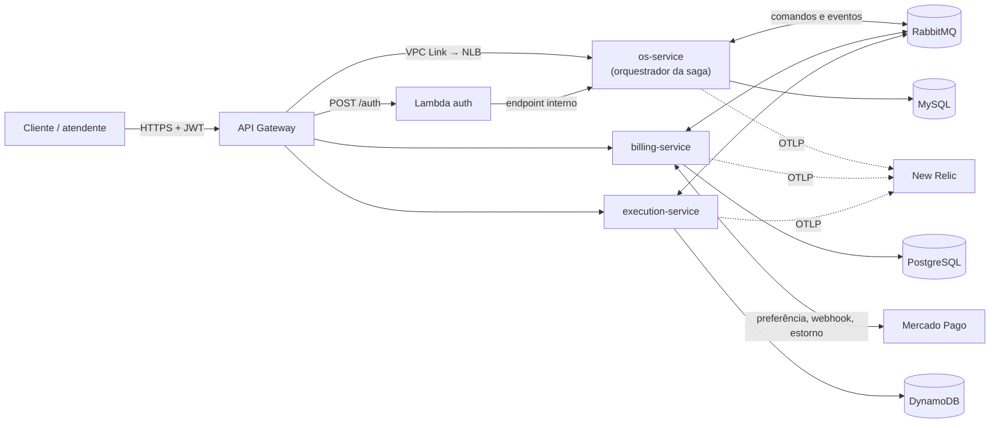

# Tech Challenge FIAP — 15SOAT · Fase 4
## Documento de entrega

> Fonte do **PDF único** para o Portal do Aluno. Preencha os campos `[preencher]` e revise. Depois
> exporte para PDF, com os diagramas renderizados: GitHub, a extensão "Markdown PDF" do VS Code com
> Mermaid, ou impressão do navegador a partir do GitHub. Os itens seguem o enunciado da Fase 4 e o
> [checklist final do plano](fase4/README.md#11-checklist-final-de-entrega).

---

### 1. Identificação

| Campo | Valor |
| --- | --- |
| Curso / turma | Software Architecture — 15SOAT |
| Fase | 4 — Microsserviços e saga |
| Grupo | `[preencher: nome/número do grupo]` |
| Data de entrega | `[preencher]` |

**Integrantes**

| Nome | RM | GitHub |
| --- | --- | --- |
| `[preencher]` | `[RM]` | `[@usuario]` |
| `[preencher]` | `[RM]` | `[@usuario]` |
| `[preencher]` | `[RM]` | `[@usuario]` |

---

### 2. Repositórios

| # | Repositório | Papel |
| --- | --- | --- |
| 1 | [oficina-os-service](https://github.com/Duds27/oficina-os-service) | Clientes, veículos, catálogo, OS e **orquestração da saga** (MySQL) |
| 2 | [oficina-billing-service](https://github.com/Duds27/oficina-billing-service) | Orçamento, aprovação, pagamento e estorno no Mercado Pago (PostgreSQL) |
| 3 | [oficina-execution-service](https://github.com/Duds27/oficina-execution-service) | Fila da oficina, diagnóstico, reparo e finalização (DynamoDB) |
| 4 | [oficina-lambda-auth](https://github.com/Duds27/oficina-lambda-auth) | Lambda de autenticação por CPF e API Gateway (rotas por serviço) |
| 5 | [oficina-infra-k8s](https://github.com/Duds27/oficina-infra-k8s) | VPC, EKS, RabbitMQ (Cluster Operator), namespaces e NLB por serviço |
| 6 | [oficina-infra-database](https://github.com/Duds27/oficina-infra-database) | RDS MySQL do os-service |

Cada repositório de serviço tem:

- código-fonte;
- Dockerfile;
- manifestos Kubernetes (`k8s/base` e overlays `local`/`aws`);
- CI e CD no GitHub Actions;
- `docs/openapi.json`;
- evidências de cobertura em `docs/evidencias`.

---

### 3. Vídeo de demonstração (≤ 15 min)

- **Link:** `[preencher: YouTube ou Vimeo, público ou não listado]`
- **Roteiro:** [`docs/roteiro-video-fase4.md`](roteiro-video-fase4.md)

| Ponto exigido | Onde aparece |
| --- | --- |
| Fluxo completo de uma OS pelos microsserviços | Bloco 2: Postman → filas no RabbitMQ → status mudando nos 3 serviços |
| Saga com falha e compensação | Bloco 3: pagamento recusado (C2) e execução rejeitada com estorno (C3) |
| Deploy automático com validação de testes | Bloco 4: PR → CI (testes, cobertura, Sonar) → merge em `homolog` → CD → rollout no EKS |
| Monitoramento e rastreamento distribuído | Bloco 5: trace da OS no New Relic, service map, dashboard "Saga de OS" e logs por `NumeroOS` |

---

### 4. Arquitetura geral

Detalhes da arquitetura:

- [diagrama de componentes](architecture/component-diagram.md);
- [diagramas de sequência](architecture/sequence-diagrams.md);
- [modelo de dados](architecture/database-model.md);
- [contratos de mensagens](contratos-mensagens.md).

---

### 5. Divisão dos microsserviços e justificativa ([ADR-005](architecture/adrs/ADR-005-microsservicos.md))

| Serviço | Responsabilidade | Banco | Por que separado |
| --- | --- | --- | --- |
| os-service | Cadastros, catálogo e estoque, OS e a saga | MySQL (RDS da Fase 3) | A OS e o estoque mudam na mesma transação, então ficam juntos com a saga, que precisa dos dois. |
| billing-service | Orçamento, aprovação e pagamento | PostgreSQL | Dinheiro e integração externa (Mercado Pago) com ciclo e regras próprios: aprovação, prazos, estorno, webhook. |
| execution-service | Fila, diagnóstico e reparo | DynamoDB | É o trabalho da oficina, com volume de escrita e consulta por etapa da fila, sem relacionamentos. |

Corte por **capacidade de negócio**, e não por camada técnica:

- cada serviço tem dados, deploy e escala próprios;
- um serviço não lê o banco do outro;
- a conversa entre eles é só por mensagens.

O catálogo de peças ficou no os-service. Separado, a reserva de peças viraria mais uma etapa e mais uma
compensação na saga, sem ganho para o negócio.

---

### 6. Tecnologias e justificativa

| Escolha | Por quê |
| --- | --- |
| .NET 8 + Clean Architecture | Continuidade das fases anteriores, com domínio isolado de banco e broker. |
| RabbitMQ + MassTransit 8.4.1 ([ADR-007](architecture/adrs/ADR-007-rabbitmq-masstransit.md)) | Saga, outbox/inbox, retry e test harness prontos. A 8.4.1 é a última Apache 2.0, pois a v9 é comercial. No EKS, o RabbitMQ roda pelo Cluster Operator oficial. |
| MySQL, PostgreSQL e DynamoDB ([ADR-008](architecture/adrs/ADR-008-persistencia-poliglota.md)) | Um banco por serviço, escolhido pela natureza dos dados: transacional relacional, financeiro com concorrência otimista, e fila com acesso por chave. |
| Mercado Pago Checkout Pro ([ADR-009](architecture/adrs/ADR-009-mercado-pago.md)) | Sandbox gratuito e estorno por API. O webhook vem com assinatura HMAC. |
| EKS + API Gateway + Lambda | A plataforma da Fase 3, agora com rotas por serviço e um listener do NLB por serviço. |
| OpenTelemetry → New Relic ([ADR-010](architecture/adrs/ADR-010-opentelemetry.md)) | O trace atravessa o RabbitMQ, e logs, métricas e traces saem pelo mesmo caminho. |
| Terraform + GitHub Actions + SonarCloud | Infra como código, pipeline por repositório e quality gate obrigatório. |

---

### 7. Estratégia da saga: orquestração ([ADR-006](architecture/adrs/ADR-006-saga-orquestrada.md))

O **os-service orquestra** a saga. A máquina de estados do MassTransit fica gravada no MySQL, na mesma
transação da OS e do estoque, e manda um comando por passo. O billing e o execution só respondem com
eventos.

**Por que orquestração:**

- o fluxo e as compensações ficam num lugar só;
- dá para consultar em que passo cada OS está (`GET /api/ordens-servico/{id}/saga`);
- o fluxo inteiro se testa de ponta a ponta.

Com coreografia, as compensações ficariam espalhadas por três repositórios.

| Compensação | Quando | O que acontece |
| --- | --- | --- |
| C1 | Orçamento recusado | Devolve as peças, cancela a execução e cancela a OS |
| C2 | Pagamento recusado, ou prazo de aprovação ou de pagamento vencido | Cancela o orçamento, devolve as peças, cancela a execução e cancela a OS |
| C3 | Execução rejeitada ou prazo de execução vencido | Estorna o pagamento no Mercado Pago, devolve as peças e cancela a OS |

**Garantias:**

- **outbox/inbox nos 3 serviços:** a mudança de estado e a mensagem são gravadas juntas, e a mensagem repetida é descartada;
- **prazos sem plugin no broker:** um verificador publica `PrazoExpirado`;
- **eventos fora de ordem ou repetidos:** são ignorados de forma explícita.

---

### 8. Qualidade

| Serviço | Testes | Cobertura de linhas (CI da `main`) | Quality gate SonarCloud |
| --- | --- | --- | --- |
| os-service | 249 + 5 BDD | 95,0% | OK |
| billing-service | 166 unitários + 33 de integração | 94,7% | OK |
| execution-service | 117 unitários + 31 de integração | 96,2% | OK |

- **Gate de cobertura (80%) e quality gate do SonarCloud:** no CI, como *required check* da `main`.
- **Testes de integração:** RabbitMQ, MySQL, PostgreSQL e DynamoDB reais via Testcontainers, e o Mercado Pago simulado no WireMock.
- **Saga de ponta a ponta:** `scripts/e2e_saga.py`, rodada no compose, num kind e num runner limpo do GitHub.
- **Evidências:** `docs/evidencias` de cada serviço, e os badges no README.

---

### 9. CI/CD e observabilidade

**CI/CD:**

- **PR:** CI com build, testes, cobertura, Sonar, OpenAPI e docker build.
- **Merge em `homolog`/`prod`:** CD com imagem no ECR, Secret do Secrets Manager, `kubectl apply`, rollout e smoke test.
- **Infra dos serviços:** `infra.yml`, com o plan comentado no PR e o apply com aprovação.

**Observabilidade** ([`docs/observability`](observability/README.md)):

- trace distribuído pelos 3 serviços e pelo RabbitMQ;
- métricas de negócio da saga, do billing e da execução;
- logs ligados ao trace e filtráveis por `NumeroOS`;
- dashboard "Saga de OS" e 8 alertas em Terraform.

---

### 10. Checklist do enunciado

- [ ] Links de todos os repositórios (seção 2)
- [ ] Link do vídeo (seção 3)
- [ ] Diagrama geral (seção 4)
- [ ] Estratégia da saga com justificativa (seção 7)
- [ ] Justificativa da divisão e das tecnologias (seções 5 e 6)
- [ ] Usuário `soat-architecture` como colaborador em todos os repositórios
