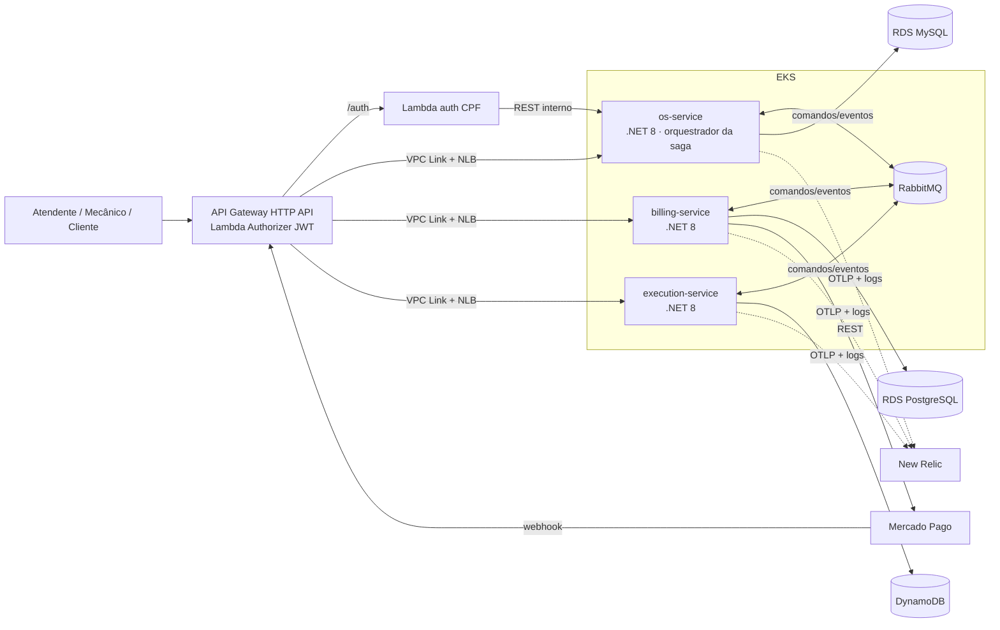
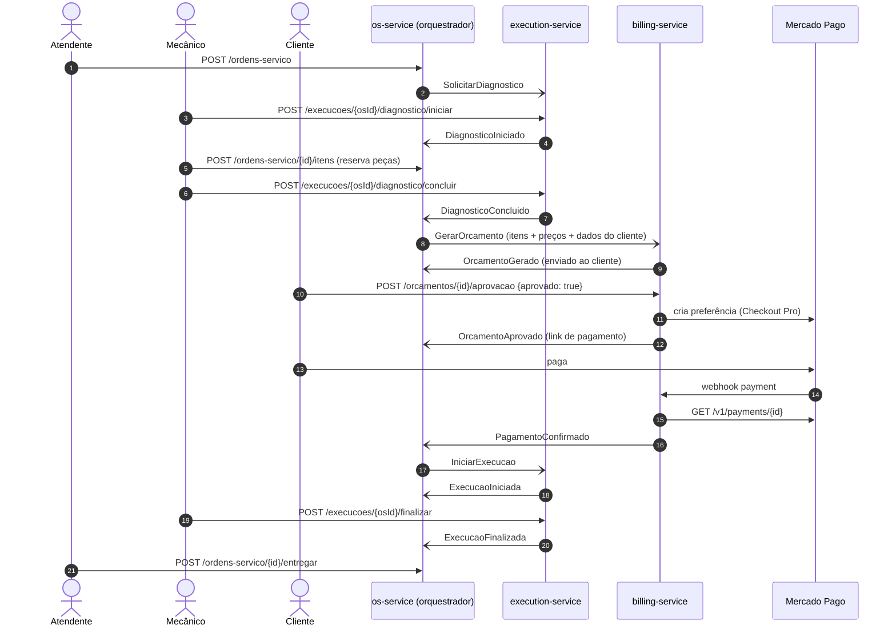
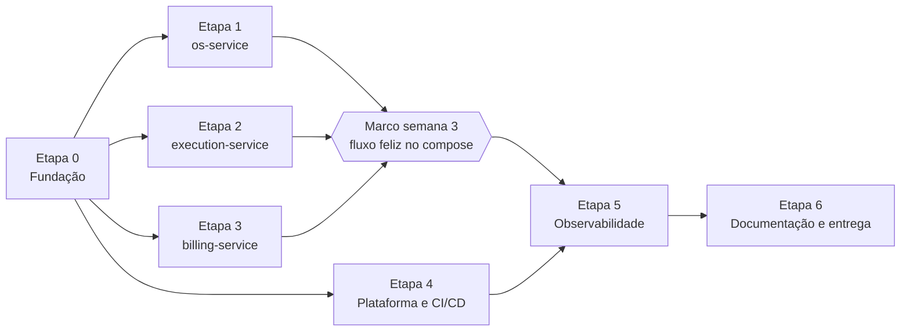

# Fase 4 — Plano de Desenvolvimento (Microsserviços + Saga Pattern)

> **Objetivo do enunciado:** refatorar a aplicação para arquitetura de microsserviços com gestão
> transacional distribuída (Saga) e automação completa de build, testes e deploy.
>
> Este plano parte do estado atual (Fase 3): monólito .NET 8 em Clean Architecture, MySQL no RDS,
> EKS + HPA, Lambda de autenticação por CPF, New Relic, 4 repositórios com CI/CD via GitHub Actions + OIDC.
>
> **Como usar:** este arquivo reúne as decisões gerais. A execução está dividida em 7 etapas, cada uma
> com seu próprio arquivo. Veja a [seção 7](#7-etapas).

---

## 1. O que muda em relação à Fase 3

| Aspecto | Hoje (Fase 3) | Fase 4 (alvo) |
| --- | --- | --- |
| Aplicação | 1 monólito (`tech-challenge-fiap` / "oficina-app") | **3 microsserviços**: `os-service`, `billing-service`, `execution-service` |
| Bancos | 1 MySQL (RDS) compartilhado | **1 banco por serviço**: MySQL (OS), PostgreSQL (Billing), **DynamoDB** (Execução) |
| Comunicação | Chamadas internas em processo | REST síncrono (borda/consultas) + **mensageria assíncrona (RabbitMQ)** |
| Consistência | Transação local (`IUnitOfWork`) | **Saga orquestrada** com compensações + outbox/inbox |
| Pagamento | Inexistente | **Mercado Pago** (sandbox) com webhook e estorno |
| Aprovação de orçamento | Endpoint no monólito | Migra para o `billing-service` |
| Histórico da OS | Só datas-marco na própria OS | Tabela de **histórico de status** + endpoint de consulta |
| Testes | xUnit + Testcontainers, sem meta de cobertura | **≥ 80% por serviço**, **BDD** do fluxo completo, **Sonar no CI** (quality gate) |
| Lambda auth | Lê o RDS diretamente | Chama um **endpoint interno do `os-service`** (nenhum acesso a banco alheio) |

---

## 2. Rastreabilidade: requisito → como atendemos

| Requisito do enunciado | Como será atendido | Onde |
| --- | --- | --- |
| ≥ 3 microsserviços independentes, cada um com repo, infra e banco | `os-service`, `billing-service`, `execution-service`, cada um com `/src`, `/tests`, `/k8s`, `/infra` (Terraform do próprio banco) e pipeline | 3 repos |
| ≥ 1 banco SQL e ≥ 1 NoSQL | MySQL (OS) e PostgreSQL (Billing) são os SQL; DynamoDB (Execução) é o NoSQL | §3.2 |
| REST síncrono quando necessário | Borda (API Gateway → serviços), Lambda → `os-service`, Billing → Mercado Pago | §3.3 |
| Mensageria assíncrona | RabbitMQ + MassTransit (comandos e eventos da saga) | §3.3 |
| Nenhum serviço acessa banco de outro | Dados replicados via eventos (*event-carried state transfer*); Lambda passa a usar HTTP | §3.3, §3.5 |
| Saga com rollback/compensação | Saga **orquestrada** no `os-service` (state machine persistida) | §5 |
| Documentar escolha da saga no README | ADR-006 + seção no README de cada serviço | [Etapa 6](etapa-6-documentacao-entrega.md) |
| Testes unitários em todos os serviços | xUnit em domínio + casos de uso | §8 |
| ≥ 1 fluxo completo com BDD | Reqnroll: feature "Ciclo de vida da OS" (caminho feliz + 3 cenários de compensação) | §8 |
| Cobertura ≥ 80% por serviço | Gate no CI (ReportGenerator consolidado) + quality gate do SonarCloud | §8 |
| SonarQube ou similar no CI | SonarCloud com quality gate como *required check* | [Etapa 4](etapa-4-plataforma-cicd.md) |
| Pipeline independente por serviço (build, testes, qualidade, deploy K8s) | `ci.yml` + `cd.yml` em cada repo; CD depende do CI | [Etapa 4](etapa-4-plataforma-cicd.md) |
| Repos protegidos | `main` com PR obrigatório + checks obrigatórios | [Etapa 4](etapa-4-plataforma-cicd.md) |
| Observabilidade da Fase 3 | New Relic: traces distribuídos atravessando o broker, logs, dashboard da saga | [Etapa 5](etapa-5-observabilidade.md) |
| Mercado Pago | Checkout Pro (sandbox) + webhook + consulta do pagamento + estorno | §3.6 |

---

## 3. Decisões de arquitetura (recomendadas)

### 3.1 Divisão dos microsserviços

| Serviço | Responsabilidade (bounded context) | Dados próprios | Banco | Repositório |
| --- | --- | --- | --- | --- |
| **os-service** | Clientes, veículos, catálogo de serviços/peças (estoque), abertura/consulta/histórico de OS, **orquestração da saga** | Cliente, Veiculo, Servico, Peca, OrdemServico, ItemOrdemServico, HistoricoStatusOS, estado da saga, outbox/inbox | **MySQL 8.4** (RDS já existente) | `oficina-os-service` (renomear o `tech-challenge-fiap`) + `oficina-infra-database` |
| **billing-service** | Geração/envio de orçamento, aprovação/recusa, pagamento (Mercado Pago), estorno | Orcamento, ItemOrcamento (snapshot), Pagamento, NotificacaoOutbox, outbox/inbox | **PostgreSQL 16** (RDS novo) | `oficina-billing-service` (novo) |
| **execution-service** | Fila de execução, diagnóstico e reparo (apontamentos, linha do tempo), comunicar finalização | Execucao + eventos de linha do tempo, dedup de mensagens | **DynamoDB** | `oficina-execution-service` (novo) |

**Por que essa divisão:** ela segue as áreas do negócio citadas no enunciado (atendimento → diagnóstico/execução → cobrança).
Cada serviço tem ciclo de vida, carga e regras próprias. O `os-service` é a evolução do monólito, então reaproveita quase todo o código e os testes atuais.
O catálogo e o estoque ficam no `os-service` porque a reserva de peças já existe lá (débito ao adicionar item, devolução ao remover). Assim a compensação "devolver peças" vira uma transação local.

### 3.2 Bancos de dados (poliglota)

- **MySQL (os-service):** dados fortemente relacionais (cliente → veículo → OS → itens), integridade referencial e unicidade (CPF, placa, NumeroOS). Já está provisionado e migrado.
- **PostgreSQL (billing-service):** dinheiro exige ACID, constraints e auditoria. Também demonstra independência tecnológica entre serviços (EF Core + Npgsql).
  - *Se o custo apertar:* uma segunda database no mesmo RDS, com usuário próprio e *grants* restritos, também serve. Mesmo assim, documentar a dívida técnica.
- **DynamoDB (execution-service):** a fila e a linha do tempo de apontamentos são documentos com esquema flexível e acesso por chave. É gerenciado, sem servidor, com custo *on-demand* praticamente zero, e tem Terraform simples. Escritas condicionais dão idempotência.
  - Modelo *single-table*: `PK = EXEC#{osId}`, `SK = META | EVT#{timestamp}`. GSI para a fila: `GSI1PK = FILA#{etapa}`, `GSI1SK = {dataEntrada}#{osId}`.

### 3.3 Comunicação

- **Assíncrona (principal): RabbitMQ + MassTransit 8.x.** O MassTransit traz a state machine de saga, outbox/inbox transacional com EF Core, retry/redelivery, filas `_error` e *test harness* (base dos testes de saga e BDD).
  - Fixar a versão **8.x** (Apache 2.0). A v9 tem licença comercial.
  - O RabbitMQ roda local (docker-compose/Testcontainers) e no EKS do mesmo jeito. A UI de management também ajuda na demonstração em vídeo.
- **Síncrona (REST):** só na borda (API Gateway → serviços), na Lambda → `os-service` (validação de CPF) e no Billing → Mercado Pago.
  - Nenhum serviço chama outro de forma síncrona dentro da saga, para evitar acoplamento temporal.
- **Dados de outros contextos:** chegam **dentro dos eventos/comandos** (ex.: `GerarOrcamento` leva nome/e-mail do cliente e os itens com preço-snapshot). Cada serviço guarda a cópia de que precisa. **Nenhum acesso a banco alheio.**
- **Contratos:** cada repo declara suas próprias classes de mensagem com `[MessageUrn("oficina:<nome>:v1")]` e `[EntityName("oficina.<nome>.v1")]`, sem biblioteca compartilhada acoplando os repos. Os contratos ficam documentados em [`docs/contratos-mensagens.md`](../contratos-mensagens.md) e são cobertos por testes de serialização (snapshot JSON).
- **Confiabilidade:** outbox/inbox do MassTransit (EF Core) no OS e no Billing. No DynamoDB, deduplicação por `MessageId` com escrita condicional + TTL. Retry exponencial → fila `_error` → alerta.

### 3.4 Saga: **orquestrada** (orquestrador dentro do `os-service`)

**Justificativa (vai para o README/ADR-006):**

- O fluxo tem muitas etapas (diagnóstico → orçamento → aprovação → pagamento → execução), ramificações (recusa, expiração) e **compensações encadeadas** (estorno + devolução de estoque + cancelamento). Um orquestrador centraliza essa lógica num lugar só, testável e legível.
- O estado de cada OS fica **persistido e consultável** (tabela da saga). Isso facilita suporte, observabilidade e a demonstração em vídeo.
- O `os-service` já é dono do ciclo de vida da OS. Colocar o orquestrador ali evita um quarto serviço só para orquestrar.
- *Trade-off aceito:* o `os-service` conhece a sequência do processo. Mitigamos isso com contratos versionados e comandos explícitos (os outros serviços não conhecem a saga).
- *Coreografia descartada:* a lógica ficaria espalhada em 3 repos, com compensações difíceis de rastrear e de testar ponta a ponta.

### 3.5 Lambda de autenticação

Hoje a Lambda consulta `Cliente` direto no RDS do que passará a ser o banco do `os-service`, o que viola a regra.
A Lambda passa a chamar `GET /internal/clientes/por-cpf/{cpf}` no `os-service`: rede privada da VPC, NLB interno, header de segredo compartilhado lido do Secrets Manager. A rota fica fora do API Gateway público.

### 3.6 Mercado Pago (billing-service)

- **Port** `IGatewayPagamento` com dois adapters: `MercadoPagoGateway` (real, sandbox) e `FakeGatewayPagamento` (testes, CI, execução local).
- **Fluxo:** aprovação do orçamento → `POST /checkout/preferences` (`external_reference = pagamentoId`, `notification_url` = rota pública do webhook) → cliente paga no Checkout Pro com usuário/cartões de teste → webhook `payment` → Billing **consulta** `GET /v1/payments/{id}` (nunca confia só no payload) → publica `PagamentoConfirmado` / `PagamentoRecusado`.
- **Estorno (compensação):** `POST /v1/payments/{id}/refunds`.
- **Segurança:**
  - Validar a assinatura `x-signature` do webhook.
  - Usar `X-Idempotency-Key` nas chamadas.
  - Guardar o access token de teste no Secrets Manager.
  - Rota `/webhooks/mercadopago` sem authorizer JWT, mas com validação de assinatura.
- **Momento do pagamento:** **após a aprovação e antes da execução**. Isso coloca uma transação financeira no meio da saga e torna a compensação mais rica (falha na execução → estorno), como o enunciado pede ("criação de OS, aprovações e pagamentos").

### 3.7 Observabilidade (reaproveitando a Fase 3)

- **New Relic** continua sendo a plataforma.
- **Traces:** OpenTelemetry .NET (ASP.NET Core, HttpClient, EF Core, AWS SDK e a `ActivitySource` do MassTransit) exportando via OTLP para o New Relic. O trace atravessa o RabbitMQ e mostra a saga inteira.
  - Validar no spike S2 (Etapa 0) se o agente .NET atual já propaga contexto pelo broker. Se não propagar, ficar com OTel nos 3 serviços.
- **Logs:** Serilog JSON (já existe) + `CorrelationId` = id da OS/saga + `NumeroOS` + `EstadoSaga` em todo log de consumer.
- **Infra:** `nri-bundle` (já existe) + métricas do RabbitMQ (plugin Prometheus).

---

## 4. Arquitetura alvo



---

## 5. Saga da Ordem de Serviço

### 5.1 Caminho feliz



`->>` = REST síncrono · `-)` = mensagem assíncrona via RabbitMQ.

### 5.2 Máquina de estados (no `os-service`)

| Estado da saga | Status da OS | Aguarda | Avança para |
| --- | --- | --- | --- |
| `AguardandoDiagnostico` | Recebida | `DiagnosticoIniciado` | `EmDiagnostico` |
| `EmDiagnostico` | Em Diagnóstico | `DiagnosticoConcluido` | `AguardandoOrcamento` |
| `AguardandoOrcamento` | Em Diagnóstico | `OrcamentoGerado` | `AguardandoAprovacao` |
| `AguardandoAprovacao` | Aguardando Aprovação | `OrcamentoAprovado` / `OrcamentoRecusado` / timeout | `AguardandoPagamento` / compensação |
| `AguardandoPagamento` | Aguardando Pagamento *(novo)* | `PagamentoConfirmado` / `PagamentoRecusado` / timeout | `AguardandoExecucao` / compensação |
| `AguardandoExecucao` | Aguardando Pagamento | `ExecucaoIniciada` / `ExecucaoRejeitada` / timeout | `EmExecucao` / `AguardandoEstorno` |
| `EmExecucao` | Em Execução | `ExecucaoFinalizada` | `Concluida` |
| `Concluida` | Finalizada → Entregue (`POST /entregar`, fora da saga) | — | fim |
| `AguardandoEstorno` | Cancelada | `PagamentoEstornado` | `Cancelada` |
| `Cancelada` | Cancelada *(novo)* | — | fim (compensada) |

Diagrama completo, compensações e eventos fora de ordem: [`docs/contratos-mensagens.md`](../contratos-mensagens.md#4-máquina-de-estados-da-saga-no-os-service).

Timeouts: em vez de depender de plugin de *delayed message* no RabbitMQ, a saga grava `PrazoExpiraEm`. Um *hosted service* no `os-service` varre sagas vencidas e publica `PrazoExpirado`. É simples, durável e testável. Prazos ficam em configuração (ex.: 48 h em produção, 2 min na demo).

### 5.3 Compensações

| Falha | Compensações (ordem reversa) | Estado final |
| --- | --- | --- |
| Cliente **recusa** o orçamento | `os`: devolve peças ao estoque · `exec`: `CancelarExecucao` | Cancelada (orçamento recusado) |
| **Prazo de aprovação** expira | `billing`: `CancelarOrcamento` · `os`: devolve peças · `exec`: `CancelarExecucao` | Cancelada |
| **Pagamento recusado** ou prazo expirado | `billing`: `CancelarOrcamento` · `os`: devolve peças · `exec`: `CancelarExecucao` | Cancelada |
| **Execução rejeitada** ou sem resposta | `billing`: `EstornarPagamento` (refund no MP) → `CancelarOrcamento` · `os`: devolve peças | Cancelada (estornada) |
| Falha técnica transitória (broker/banco) | Retry exponencial + redelivery; esgotou → fila `_error` + alerta no New Relic | Sem mudança de estado |

Todas as compensações são **idempotentes**, porque a mesma mensagem pode chegar duas vezes.
Para a demo, o `execution-service` tem uma flag `FaultInjection__RejeitarExecucao` (ConfigMap, desligada por padrão) que força o cenário de estorno.

---

## 6. Mapa de repositórios

| Repositório | Situação | Mudanças na Fase 4 |
| --- | --- | --- |
| `oficina-os-service` | **Renomear** `tech-challenge-fiap` (o GitHub redireciona as URLs antigas) | Saga + mensageria + histórico + endpoint interno p/ Lambda; remover aprovação de orçamento |
| `oficina-billing-service` | **Novo** | Serviço completo + Terraform do RDS PostgreSQL |
| `oficina-execution-service` | **Novo** | Serviço completo + Terraform da tabela DynamoDB + IAM (IRSA) |
| `oficina-lambda-auth` | Existente | Lambda via HTTP no `os-service`; rotas do API GW por serviço; rota pública do webhook |
| `oficina-infra-k8s` | Existente | RabbitMQ, namespaces, listeners/target groups do NLB por serviço, EBS CSI (se faltar), OIDC/IRSA |
| `oficina-infra-database` | Existente | Sem mudança funcional. Documentar que é a infra de banco do `os-service` |

Estrutura padrão de cada microsserviço (espelha o monólito atual):

```
src/<Servico>.Domain | .Application | .Infrastructure | .API
tests/<Servico>.UnitTests | .IntegrationTests (| .BddTests no os-service)
k8s/base + k8s/overlays/{local,aws}
infra/            # Terraform do banco/recursos do próprio serviço
.github/workflows/ci.yml, cd.yml
Dockerfile, docker-compose.yml, README.md, sonar-project / Directory.Build.props
```

---

## 7. Etapas

> Cada etapa tem um arquivo próprio com objetivo, pré-requisitos, tarefas detalhadas, PRs sugeridos, testes e critério de pronto.
> As semanas são estimativas para ~6 semanas a partir de 16/11/2026. **Ajustar ao prazo oficial do portal.**
> Marco intermediário: **fluxo feliz ponta a ponta no docker-compose ao fim da semana 3**, com o gateway de pagamento Fake.

| # | Etapa | Semanas | Frente | Depende de | Entregável principal |
| --- | --- | --- | --- | --- | --- |
| 0 | [Fundação e *contract-first*](etapa-0-fundacao.md) | 1 | Todas | — | 3 repos com CI verde, contratos v1, spikes decididos |
| 1 | [`os-service` + orquestrador da saga](etapa-1-os-service.md) | 1–3 | A | 0 | Saga completa com compensações + BDD verde |
| 2 | [`execution-service`](etapa-2-execution-service.md) | 2–3 | C | 0 | Fila de execução em DynamoDB respondendo à saga |
| 3 | [`billing-service` + Mercado Pago](etapa-3-billing-service.md) | 2–4 | B | 0 (spike S3) | Orçamento, pagamento no sandbox, webhook e estorno |
| 4 | [Plataforma: infra, K8s e CI/CD](etapa-4-plataforma-cicd.md) | 2–5 | D | 0 (spike S4) | Deploy automático dos 3 serviços no EKS |
| 5 | [Observabilidade distribuída](etapa-5-observabilidade.md) | 5 | D | 1–4 | Trace único da OS no New Relic + dashboard da saga |
| 6 | [Documentação e entrega](etapa-6-documentacao-entrega.md) | 6 | Todas | 1–5 | READMEs, Postman, vídeo e PDF |



---

## 8. Estratégia de testes e qualidade

| Tipo | Onde | Ferramentas | Observação |
| --- | --- | --- | --- |
| Unitário | Domínio + casos de uso dos 3 serviços | xUnit | Base da cobertura de 80% |
| Saga (state machine) | `os-service` | MassTransit Test Harness (in-memory) | Cada transição e cada compensação |
| **BDD (fluxo completo)** | `os-service` | **Reqnroll** (sucessor do SpecFlow) + xUnit + Test Harness | Ver feature abaixo |
| Integração | Os 3 serviços | Testcontainers (MySQL, PostgreSQL, LocalStack/DynamoDB Local, RabbitMQ), WireMock (MP) | Mesmo provider da produção |
| Contrato de mensagens | Os 3 serviços | Snapshot JSON das mensagens | Evita quebrar outro repo sem perceber |
| E2E (opcional) | `docker-compose.full.yml` | Newman (collection Postman) | Ensaio do vídeo |

Feature BDD (resumo):

```gherkin
Funcionalidade: Ciclo de vida da Ordem de Serviço coordenado por Saga

  Cenário: OS percorre todo o fluxo com sucesso
    Dado uma OS aberta para um cliente com veículo cadastrado
    Quando o diagnóstico é concluído com 1 serviço e 1 peça
    E o cliente aprova o orçamento
    E o pagamento é confirmado pelo Mercado Pago
    E a execução é finalizada
    Então a OS deve estar "Finalizada"
    E o histórico deve conter todas as transições em ordem

  Cenário: Cliente recusa o orçamento
    ...Então a OS deve estar "Cancelada" e a peça deve voltar ao estoque

  Cenário: Pagamento recusado
    ...Então o orçamento deve ser cancelado e a OS "Cancelada"

  Cenário: Execução rejeitada após pagamento
    ...Então o pagamento deve ser estornado, a peça devolvida e a OS "Cancelada"
```

**Gate de cobertura:**

- No CI, o ReportGenerator consolida a cobertura de todos os projetos de teste e o job falha se a cobertura de linhas ficar abaixo de 80% ([Etapa 4](etapa-4-plataforma-cicd.md#44-ci-githubworkflowsciyml-igual-nos-3-repos)).
- Quality gate do SonarCloud ("Sonar way": cobertura ≥ 80% no código novo, sem bugs ou vulnerabilidades novas) como check obrigatório no PR.
- Exclusões legítimas e documentadas: `Migrations/`, `*.Designer.cs`, `Program.cs`, DTOs.

---

## 9. Frentes de trabalho (para o grupo)

| Frente | Escopo | Depende de |
| --- | --- | --- |
| **A — OS & Saga** | [Etapa 1](etapa-1-os-service.md) + BDD + ajuste da Lambda | Contratos (Etapa 0) |
| **B — Billing & Pagamentos** | [Etapa 3](etapa-3-billing-service.md) + Mercado Pago | Contratos, spike S3 |
| **C — Execução** | [Etapa 2](etapa-2-execution-service.md) + DynamoDB | Contratos |
| **D — Plataforma** | [Etapas 4](etapa-4-plataforma-cicd.md) e [5](etapa-5-observabilidade.md) (infra, CI/CD, Sonar, New Relic) | Spikes S2 e S4 |

Se a equipe for menor, a ordem sugerida é: **Etapa 0 → 1 → 2 → 3 → 4 → 5 → 6**. A Etapa 4 (CI de cada repo) entra assim que o repo nasce.

Os contratos de mensagens são o ponto de integração entre as frentes: mudar um contrato exige PR revisado pelas frentes afetadas e nova versão do `MessageUrn` (`:v2`).

---

## 10. Roteiro do vídeo (≤ 15 min)

| Bloco | Conteúdo | Tempo |
| --- | --- | --- |
| 1 | Arquitetura: 3 serviços, bancos, RabbitMQ e o porquê da saga orquestrada | 2 min |
| 2 | **Fluxo completo de uma OS** (Postman) mostrando filas no RabbitMQ e status mudando nos 3 serviços; pagamento no sandbox do MP | 4 min |
| 3 | **Saga com falha**: pagamento recusado + execução rejeitada (flag) → estorno, devolução de estoque, OS cancelada | 3 min |
| 4 | **Deploy automatizado** de um serviço: PR → CI (testes, cobertura, Sonar) → merge em `homolog` → CD → rollout no EKS | 3 min |
| 5 | **New Relic**: trace distribuído da OS, service map, dashboard da saga, logs correlacionados | 2 min |
| 6 | Fechamento | 1 min |

---

## 11. Checklist final de entrega

**Por repositório (3 microsserviços):**

- [ ] Código-fonte
- [ ] Dockerfile + manifestos K8s
- [ ] Pipelines CI/CD
- [ ] Evidência de cobertura ≥ 80% (print/badge no README)
- [ ] Documentação da arquitetura do serviço
- [ ] Swagger / collection Postman atualizada

**Plataforma:**

- [ ] `main` protegida nos repos (PR + checks)
- [ ] SonarCloud com quality gate obrigatório
- [ ] Deploy automático no EKS
- [ ] RabbitMQ no cluster
- [ ] New Relic com traces distribuídos

**Vídeo:** link YouTube/Vimeo (público ou não listado), ≤ 15 min, cobrindo os 4 pontos exigidos.

**PDF no portal:**

- [ ] Nome e identificação dos participantes
- [ ] Links de todos os repositórios
- [ ] Link do vídeo
- [ ] Diagrama geral (serviços, bancos, comunicação)
- [ ] Estratégia da saga (orquestração) com justificativa
- [ ] Justificativa da divisão dos microsserviços e das tecnologias

---

## 12. Riscos e mitigações

| Risco | Mitigação |
| --- | --- |
| Custo AWS (EKS + 2 RDS + NLB) | Ambiente de dev em kind/docker-compose; `terraform destroy` fora das janelas de teste e gravação; RDS `db.t4g.micro` |
| Licença MassTransit v9 (comercial) | Fixar MassTransit **8.x** (Apache 2.0); alternativa: Wolverine |
| Imagens/charts Bitnami mudaram de distribuição | Usar o **RabbitMQ Cluster Operator** oficial |
| Webhook do MP precisa de URL pública | Rota pública no API Gateway; em dev local, túnel (ex.: cloudflared) |
| Trace não atravessar o broker | Spike S2 logo na semana 1; plano B = OpenTelemetry → OTLP New Relic |
| Cobertura baixa do monólito herdado | Exclusões documentadas + testes novos desde a Etapa 1; gate ligado cedo |
| Integração entre frentes atrasar | *Contract-first* + harness/fakes. Cada serviço evolui sozinho e a integração real é o marco da semana 3 |
| Lambda acessando banco de outro serviço | Migrar para HTTP interno (Etapa 1) |
| Consistência eventual confundir o usuário | Status intermediários explícitos ("Aguardando Pagamento") + histórico consultável |

---

## 13. Pontos para confirmar com o grupo

1. **Prazo oficial** de entrega, para fixar as datas das etapas.
2. **Momento do pagamento:** recomendado após a aprovação e antes da execução (§3.6). A alternativa (pagar na entrega) simplifica a saga, mas tira o estorno do fluxo.
3. **RDS separado para o Billing** (recomendado) ou database lógica no RDS existente, por custo.
